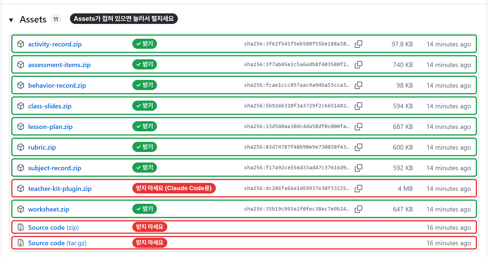
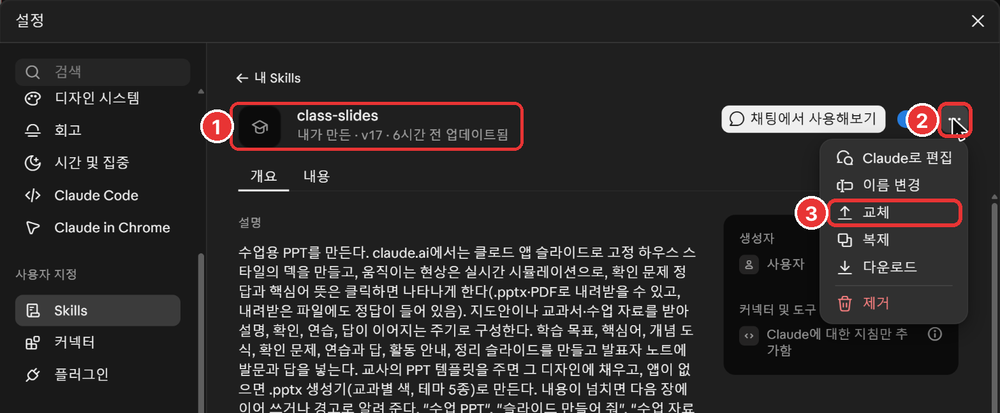

<p align="center">
  
</p>

<div align="center">

[](https://github.com/akaz01/claude-teacher/releases/latest)
[](https://github.com/akaz01/claude-teacher/actions/workflows/test.yml)
[](LICENSE)


**스킬 10개** | 수업 · 평가 · 학생부 | 한글(hwpx) · PPT | 성취기준 4,451개 | claude.ai · Claude Code

</div>

---

<div align="center">

<a href="#설치하기"></a>
<a href="#최신판으로-업데이트하기"></a>
<a href="#이렇게-쓰세요"></a>
<a href="#스킬-목록"></a>
<a href="#업데이트-소식"></a>
<a href="#문의와-오류-제보"></a>

</div>

---

<br>

<p align="center"><b>지도안, 학습지, 수업 PPT, 시험지, 학생부 초안을 학교 양식에 바로 쓰도록 만듭니다.</b></p>

<p align="center">초·중·고 교사의 수업·평가·학교생활기록부 업무를 돕는 Claude 스킬 10개입니다.<br>
결과물은 학교에서 바로 쓰도록 <b>한글(hwpx)</b>과 파워포인트 파일로 만들고, 학교 엑셀 양식을 주시면 그 파일에 채웁니다.<br>
<b>claude.ai(웹, 데스크톱 앱)와 Claude Code에서 쓸 수 있습니다.</b></p>

| 처음이세요? | 쓰고 계세요? | 쓰는 법 | 막히셨나요? |
|:---:|:---:|:---:|:---:|
| **[그림으로 보는 설치 안내](docs/install.md)** | **[최신판으로 업데이트](#최신판으로-업데이트하기)** | **[사용법](docs/usage.md)** | **[자주 묻는 질문](docs/faq.md)** |
| 단계마다 그림으로 | zip 교체 · 플러그인 명령 | 부르는 말과 요청 예시 | 파일 · 스킬 문제 해결 |

<br>

---

# 📘 소개

## 이런 원칙으로 만들었습니다

- **학교 양식이 먼저입니다**<br>
  지도안, 학습지, 평가계획서, 채점기준표, 시험지는 학교 양식(hwpx)을 주시면 그 파일에 내용만 채웁니다. 용지와 글자 모양은 그대로이고, 표에 행을 더하거나 수식·그림을 넣는 일은 하지 못해 따로 알려 드립니다. 수업 PPT는 템플릿을 주시면 그 디자인에 내용을 채웁니다. 양식이 없으면 교과별 기본 폼으로 만듭니다.

- **지어내지 않습니다**<br>
  성취기준, 기재요령, 날짜처럼 확인이 필요한 것은 `[확인 필요]`처럼 빈칸으로 두고 마지막에 "채워 넣을 곳"을 알려 드립니다.

- **핵심 수치는 묻습니다**<br>
  정기시험은 문항 수·배점을 먼저 여쭙고, 형성평가·단원평가는 기본 구성으로 초안을 만든 뒤 바꿀 값을 여쭙니다. 주당 시수 같은 다른 숫자는 학교급 기본값을 예시로 보여 드리고 선생님께 확인받습니다.

- **학생 개인정보를 보호합니다**<br>
  학교생활기록부 자료에 학생 실명이나 연락처가 보이면 작업을 멈추고 지운 뒤 다시 올려 달라고 안내합니다. 학생은 `학생A`, `학생B`처럼 가명으로 다룹니다. 출석번호(`1번`)는 반 정보와 겹치면 누구인지 알 수 있어 가명으로 쓰지 않습니다.

- **성취기준 데이터베이스가 들어 있습니다**<br>
  2022 개정 교육과정 성취기준 4,451개(해설 포함)가 들어 있어, 성취기준을 주지 않으셔도 찾아서 제안합니다.

> **hwp 파일은 hwpx로 저장해 주세요:** 한글에서 파일 열기 → [파일] → [다른 이름으로 저장] → 파일 형식을 '한글 문서(*.hwpx)'로 고르기

## 스킬 목록

| 영역 | 부르는 말 | 스킬 | 하는 일 | 결과물 |
|:---:|:---:|---|---|:---:|
| **수업** | `단원:` | `unit-design` | 단원 설계(백워드·개념기반·GRASPS), 평가 배치, 차시 흐름 | 한글 |
| | `지도안:` | `lesson-plan` | 과정안(약안·세안), 성취기준 찾기, 교사 프로필 | 한글 |
| | `PPT:` | `class-slides` | 설명 → 확인 → 연습 → 답 수업 PPT | PPT |
| | `학습지:` | `worksheet` | 학습지·활동지 (학생용, 교사용 정답) | 한글 |
| **평가** | `수행평가:` | `rubric` | 채점기준표, 학업성적관리규정 점검 | 한글 |
| | `문항:` | `assessment-items` | 문항 출제·정답 검증, 원안지, 문항정보표 | 한글 |
| | `교과진도:` | `course-plan` | 교과진도평가계획(학사일정으로 주별 진도표, 평가 계획, 수행평가 세부기준) | 한글 |
| **학생부** | `세특:` | `subject-record` | 교과세특 초안, 기재요령·글자 수 점검 | 대화 |
| | `창체:` | `activity-record` | 창체 특기사항 초안 (자율·자치·진로·동아리) | 대화 |
| | `행특:` | `behavior-record` | 행동특성 및 종합의견 초안 | 대화 |

> - **학교 양식이 없으면** 기본 양식(학습과정안, 수행평가 세부 계획, 2단 원안지)에 채웁니다.
> - **시험 문항**은 정답을 직접 풀어 검증하고, 원안지·학생용 문제지, 정답 및 채점기준, 문항정보표를 함께 냅니다.
> - **교과세특**은 초등이면 성취수준 및 특기사항으로 씁니다.
> - **수업 PPT**는 claude.ai에서 모든 선생님께 같은 디자인의 앱 슬라이드로, 앱 기능이 없으면 교과별 색의 파워포인트로 만듭니다. 테마는 묻지 않고 교과에 맞게 고릅니다. 원하시면 말씀해 주세요.
> - **학생부**: 창체의 자율·자치·진로는 담임교사, 동아리는 동아리 담당교사가 씁니다. 봉사활동은 쓰지 않습니다. 개인정보 지우는 법 안내와 나이스에 옮기기 전 점검(NEIS 바이트)도 합니다.

<br>

---

# 🧩 설치와 업데이트

## 설치하기

> **그림과 함께 보는 자세한 안내: [설치와 업데이트](docs/install.md)** — 화면마다 어디를 누르는지 그림으로 보여 드립니다.

쓰시는 곳에 맞게 하나만 고르세요.

| 쓰는 곳 | 방법 | 설치하는 것 |
|---|---|---|
| **claude.ai** (웹, 데스크톱 앱) | 스킬 zip을 올립니다 | 필요한 스킬만 골라서 |
| **Claude Code** (터미널) | 플러그인 명령 두 줄 | 스킬 10개와 문서 만드는 도구 모두 |

### claude.ai (웹, 데스크톱 앱)

#### 1단계: 코드 실행 켜기

[그림으로 보기 →](docs/install.md#1-1-클라우드에서-코드-실행-켜기)

설정 → **기능** → **클라우드에서 코드 실행**을 켭니다. 한글(hwpx)·파워포인트 파일을 만들려면 꼭 켜야 합니다.

#### 2단계: 스킬 zip 내려받기

[그림으로 보기 →](docs/install.md#1-2-릴리스-페이지에서-스킬-zip-내려받기)

[릴리스 페이지](https://github.com/akaz01/claude-teacher/releases/latest)의 **Assets** 목록에서 **스킬 이름으로 된 zip**을 내려받습니다. 필요한 것만 골라도 됩니다.

```text
# 수업
lesson-plan.zip      class-slides.zip      worksheet.zip

# 평가
rubric.zip           assessment-items.zip

# 학교생활기록부
subject-record.zip   activity-record.zip   behavior-record.zip
```

> **주의:** `teacher-kit-plugin.zip`과 `Source code`는 받지 않습니다. claude.ai에 올리면 오류가 납니다.



#### 3단계: 스킬 올리기

[그림으로 보기 →](docs/install.md#1-3-skills-메뉴에서-올리기)

설정 → **Skills** → **+ 추가** → **Skill 업로드**에서 zip을 하나씩 올립니다.

> **주의:** zip의 **압축을 풀지 말고** 그대로 올립니다.

#### 4단계: 확인하기

[그림으로 보기 →](docs/install.md#1-4-잘-설치됐는지-확인)

새 대화에서 아래처럼 써서 스킬이 일하는지 확인합니다.

```text
지도안: 초5 사회 국토의 위치 1차시
```

### Claude Code (플러그인)

플러그인 `teacher-kit`에는 스킬 10개와 한글(hwpx)·파워포인트 파일을 만드는 도구가 모두 들어 있습니다. 골라 설치하는 방식이 아닙니다.

```text
# 마켓플레이스 추가
/plugin marketplace add akaz01/claude-teacher

# 플러그인 설치
/plugin install teacher-kit@claude-teacher
```

업데이트는 아래 [최신판으로 업데이트하기](#최신판으로-업데이트하기)를 보세요. 그림 안내: [설치와 업데이트 2장](docs/install.md#2-claude-code-플러그인)

### 처음 쓰실 때

```text
프로필 설정해 줘
```

교사 프로필(학교급, 교과, 학년)을 만들어 두시면 매번 묻지 않습니다. 자세한 순서와 그림은 [설치와 업데이트](docs/install.md)를 보세요.

## 최신판으로 업데이트하기

> 새 판이 나오면 [업데이트 소식](#업데이트-소식)에 무엇이 바뀌었는지, 어떤 스킬을 바꾸면 되는지 적어 둡니다. 지금 최신판: [](https://github.com/akaz01/claude-teacher/releases/latest)

### claude.ai (웹, 데스크톱 앱)

#### 1단계: 새 판 zip 내려받기

[릴리스 페이지](https://github.com/akaz01/claude-teacher/releases/latest)의 **Assets**에서 바뀐 스킬의 zip을 받습니다. 어떤 스킬이 바뀌었는지는 [업데이트 소식](#업데이트-소식)에 있습니다.

#### 2단계: 같은 이름 스킬에 올려 교체하기

설정 → **Skills** → 바꿀 스킬 이름(예: `assessment-items`) 누르기 → 오른쪽 위 **⋯** → **교체** → **같은 이름**의 새 zip 올리기



> **주의:** 새로 **추가**하지 말고 **교체**합니다. 추가하면 같은 이름 스킬이 두 개가 되어 어느 것이 불릴지 알 수 없습니다. 이전 판은 버전 기록에 남습니다.

[그림으로 보기 →](docs/install.md#1-5-새-판이-나왔을-때-업데이트)

### Claude Code (플러그인)

터미널에서 아래 두 줄을 입력하고 Claude Code를 다시 시작합니다.

```bash
# 1. 마켓플레이스 목록 새로 고침
claude plugin marketplace update claude-teacher

# 2. 플러그인을 최신판으로 업데이트 (다시 시작하면 적용)
claude plugin update teacher-kit@claude-teacher
```

```bash
# 설치된 판 확인
claude plugin list
```

<br>

---

# ✍️ 사용하기

## 이렇게 쓰세요

대화의 첫 마디를 아래처럼 시작합니다. 말로 부탁하셔도 됩니다. 예: "중간고사 한국사 20문항 내 줘".

| 하고 싶은 일 | 이렇게 시작하세요 |
|---|---|
| 지도안 | `지도안: 초5 사회 국토의 위치 1차시` |
| 수업 PPT | `PPT: 고1 통합사회 인권 보장` |
| 학습지 (수업 중에 푸는 한 장짜리 형성평가지·복습지 포함) | `학습지: 중1 과학 물질의 구성 1차시` |
| 수행평가 채점기준표 | `수행평가: 고2 국어 토론 발표` |
| 시험·평가 문항 (정답 및 채점기준, 문항정보표까지) | `문항: 중2 수학 일차함수 형성평가` |
| 교과세특 | `세특: 고1 통합과학` |
| 창체(자율·동아리·진로) | `창체: 고2 자율활동` |
| 행동특성 및 종합의견 | `행특: 중3` |
| 학생부(세특·창체·행특 중 무엇인지 모를 때) | `학생부: ...` (세특·창체·행특 중 무엇인지 먼저 여쭤봅니다) |

> 질문 없이 바로 만들어 달라고 하시면 기본값으로 만들고, 쓴 값은 답변 맨 위에 알려 드립니다.

스킬마다 부르는 말, 요청 예시, 함께 주면 좋은 자료, 주의할 점은 [사용법](docs/usage.md)에 있습니다. 학교 양식을 쓰는 법도 거기에 있습니다.

## 더 알아보기

| 문서 | 담긴 내용 |
|---|---|
| [설치와 업데이트](docs/install.md) | claude.ai와 Claude Code 설치, 새 판 올리기, 교사 프로필 만들기 |
| [사용법](docs/usage.md) | 어떤 스킬을 쓸지, 스킬 10개 사용법, 학교 양식 쓰는 법 |
| [자주 묻는 질문](docs/faq.md) | 파일이 안 만들어질 때, 스킬이 안 불릴 때, 개인정보로 멈췄을 때 등 |

<br>

---

# 📣 소식

## 업데이트 소식

### 0.6.0 (2026-11-21) — 단원 설계(`unit-design`)와 교과진도평가계획(`course-plan`)

- **새 스킬: 단원 설계** (`단원:`)
  - 백워드 설계(UbD 3단계), 개념기반 탐구, GRASPS 수행과제로 단원을 설계합니다.
  - 결과는 한글(hwpx) 단원 설계서입니다.
- **새 스킬: 교과진도평가계획** (`교과진도:`)
  - 한 과목 한 학기의 교수·학습 및 평가 운영 계획을 한글(hwpx)로 만듭니다.
  - **학사일정 파일**을 주면 주별 기간, 공제일수, 시수와 시수 누계를 계산합니다. 시수는 한 반 기준 주당 시수로 셉니다.
  - 중·고는 실제 학교 교과진도평가계획 양식에 채웁니다. 학교 양식을 주면 그 양식에 채웁니다.
  - 학교 학업성적관리규정에 따라 바꿀 곳(반영 비율, 기본점수, 결시 처리 등)에는 **노란 형광펜과 메모**를 답니다. 메모에 형광펜과 메모를 지우는 법이 들어 있습니다.
  - 표가 쪽 끝에서 머리행만 남기고 잘리지 않게 쪽을 나눕니다.
- 함께 바뀐 스킬
  - `lesson-plan`, `rubric`: 새 두 스킬과 맡는 일을 나눈 설명을 고쳤습니다.
  - 그 밖의 스킬: 한글 문서를 만드는 공용 도구가 조금 바뀌어 모두 새 판입니다.

#### 0.6.0으로 업데이트하는 법

**claude.ai:** [릴리스 페이지](https://github.com/akaz01/claude-teacher/releases/latest)에서 스킬 zip 10개를 받아 올립니다. 이미 있는 스킬은 같은 이름으로 올리면 교체할지 묻습니다. `unit-design.zip`, `course-plan.zip`은 새로 올립니다.

**Claude Code:** 터미널에서 입력하고 다시 시작합니다.

```bash
claude plugin marketplace update claude-teacher
claude plugin update teacher-kit@claude-teacher
```

### 0.5.0 (2026-11-18) — 시험 문항(`assessment-items`)과 원안지 배치

- **문항은 자료를 읽어야 풀리게 냅니다.** 사료, 대화, 표, 그래프, 그림 같은 자료를 모든 문항에 붙입니다. 이름 하나를 맞히는 문항이나 자료 없이 <보기>만 고르는 문항은 내지 않습니다.
- **다른 문항으로 답을 알 수 없게 합니다.** 출제 뒤 정답을 가린 채 다른 문항만 읽고 답이 드러나는지 따로 검토합니다. 정답 번호가 같은 순서로 되풀이되면 도구가 알려 줍니다.
- **수능 시험지를 기준으로 배치합니다.**
  - 밑줄은 문두 따옴표 안 말과 같은 범위에만 긋습니다.
  - 출처는 (가)·(나) 자료마다 바로 아래에 "- 『신한민보』, 1910. 7. 6. -" 꼴로 답니다. "(재구성)"은 쓰지 않습니다.
- **원안지가 더 읽기 좋아졌습니다.**
  - 두 줄짜리 선지가 다음 선지에 붙던 문제를 고쳐, 선지 사이를 줄 간격과 같게 맞춥니다.
  - 발문은 양쪽 정렬, 선지는 왼쪽 정렬입니다. 줄은 글자 단위로 넘겨 낱말 사이가 벌어지지 않습니다.
  - 배점 앞은 보통 빈칸이라 한글에서 바로 고칠 수 있습니다.
- **자료 표와 그림**: 연표·통계표를 칸 있는 표로 넣고, 그림 두 장을 나란히 놓습니다. 빈칸은 실선으로 표시합니다.
- 함께 바뀐 스킬: 한글 문서를 만드는 공용 도구가 바뀌어 `lesson-plan`, `worksheet`, `rubric`도 새 판입니다(표 칸 넘침 알림, 수식 폭 보정).

#### 0.5.0으로 업데이트하는 법

**claude.ai:** [릴리스 페이지](https://github.com/akaz01/claude-teacher/releases/latest)에서 아래 zip을 받아, 설정 → **Skills**에서 같은 이름 스킬마다 **⋯ → 교체**로 올립니다.

```text
assessment-items.zip   lesson-plan.zip   worksheet.zip   rubric.zip
```

**Claude Code:** 터미널에서 입력하고 다시 시작합니다.

```bash
claude plugin marketplace update claude-teacher
claude plugin update teacher-kit@claude-teacher
```

<br>

---

# 🔒 안전하게 쓰기

## 꼭 확인해 주세요

> **결과물은 초안입니다.** 성취기준, 기재요령, 학업성적관리규정은 해마다 바뀔 수 있으니 소속 학교와 교육청 지침을 확인해 주세요.

- 학생 정보는 아래 "학생 자료를 올리기 전에"대로 지운 뒤 올리고, 소속 교육청의 생성형 AI 활용 지침을 따라 주세요.
- 정기시험 문항은 출제 보안에 유의해 주세요.

## 학생 자료를 올리기 전에

학생 자료는 **선생님 컴퓨터에서 먼저 지운 뒤** 올려 주세요. 자료는 올리는 순간 학교 밖 서비스로 나갑니다. 올라온 뒤에 지워도 이미 나간 정보는 되돌릴 수 없습니다. 그래서 반드시 올리기 전에 지워 주셔야 합니다. 스킬도 올라온 뒤에야 자료를 볼 수 있어서 업로드 자체를 막거나 대신 지워 드리지 못합니다. 실명이나 연락처가 보이면 작업을 멈추고, 그 대화를 삭제한 뒤 새 대화에서 다시 올려 달라고 안내합니다.

학교가 허용한 계정을 쓰시고, 계정 설정에서 대화 내용이 학습에 쓰이지 않도록 되어 있는지 확인해 주세요.

- **한글 문서:** [편집 > 찾아 바꾸기]로 학생 이름을 `학생A`, `학생B`로 바꿉니다. 머리말·꼬리말과 표 안도 확인합니다. [파일 > 문서 정보]에서 지은이도 지웁니다.
- **엑셀:** 이름, 학번, 연락처 열을 삭제합니다. 숨긴 시트·열이 없는지 시트 이름을 오른쪽 클릭해 [숨기기 취소]로 확인합니다. [파일 > 정보 > 문제 확인 > 문서 검사]로 작성자 정보를 지웁니다.
- **파일 이름:** `3반_홍길동_보고서`처럼 이름이 든 파일은 `학생A_보고서`로 바꿉니다.
- **사진·스캔:** 이름표, 명찰, 얼굴, 손글씨 이름을 가린 뒤 찍거나 저장합니다.
- **대화창에 쓰는 글:** 처음부터 `학생A`, `학생B`로 씁니다. 출석번호 대신 임의 기호를 씁니다.
- **겹치는 단서:** 이름을 지워도 학년·반과 질병, 가족 사항, 그 학교에 한 명뿐인 경험이 겹치면 누구인지 알 수 있습니다. 필요 없는 단서는 함께 지웁니다.
- **대조표:** "학생A = 누구"라는 표는 선생님 컴퓨터에만 두고 올리지 않습니다. 결과 문장을 나이스에 옮길 때 이 표로 맞춥니다.

<br>

---

# 📮 문의와 라이선스

## 문의와 오류 제보

> 사용 문의, 버그나 오류 제보: **akazhoon@gmail.com**

어떤 스킬에서 어떤 요청을 했는지, 어떤 결과가 나왔는지 적어 주시면 빨리 고칠 수 있습니다. 학생 개인정보가 든 자료나 화면은 보내지 마세요.

## 라이선스

Copyright (c) 2026 AkazHoon

teacher-kit은 [크리에이티브 커먼즈 저작자표시-비영리 4.0 국제 라이선스(CC BY-NC 4.0)](https://creativecommons.org/licenses/by-nc/4.0/deed.ko)를 따릅니다. 전문은 [LICENSE](LICENSE)에 있습니다.

- **할 수 있는 것:** 출처(AkazHoon, teacher-kit)를 표시하면 수업, 학교 업무, 연수처럼 비영리 목적으로 자유롭게 쓰고, 고치고, 나눌 수 있습니다.
- **허락이 필요한 것:** 판매, 유료 강의·서비스에 포함하기 같은 영리 목적 이용

저작권, 영리 이용 허락, 사용 문의, 버그나 오류 제보는 **akazhoon@gmail.com**으로 보내 주세요.

## 출처

아래 자료는 teacher-kit의 라이선스가 아니라 각자의 원래 라이선스를 따릅니다.

- 성취기준 데이터: [greatsong/k-curriculum-2022](https://github.com/greatsong/k-curriculum-2022) v3.0.1 (CC BY 4.0). 원 출처는 교육부 고시 2022 개정 교육과정입니다.
- 한글 문서 골격: python-hwpx의 Skeleton.hwpx (Apache-2.0). `shared/scripts/make_hwpx_LICENSE.txt`, `make_hwpx_NOTICE.txt` 참고
- 기본 양식은 시도교육청이 공개한 지침과 예시 서식, 학교 홈페이지에 공개된 문서의 공통 구조를 참고했습니다.

<br>

---

# 🛠 개발자용

```
skills/<스킬>/SKILL.md      스킬 본문 (일부는 scripts/ 포함)
shared/                     여러 스킬이 함께 쓰는 참고 자료
                            (문체, 개인정보, 학교급, 점검표, 성취기준, 양식 채우기)
shared/scripts/             공용 스크립트
                            (make_hwpx.py, make_hwpx_zip.py, fill_hwpx.py,
                             fill_exam.py, fill_xlsx.py, neis_bytes.py)
tools/build.py              스킬별 zip과 플러그인 폴더를 만든다
```

- SKILL.md가 `references/…`, `scripts/…`로 가리키는 파일을 `tools/build.py`가 shared/에서 찾아 각 zip에 넣습니다.
- 빌드: `python tools/build.py` → `dist/claude-ai/<스킬>.zip`, `dist/plugin/teacher-kit/`
- 개발 도구 설치: `python -m pip install -r requirements-dev.txt`
- 테스트: 저장소 루트에서 `python -m pytest` (tools/, shared/scripts/, 스킬별 scripts/의 테스트를 모두 돌립니다)
- GitHub에 올리면 GitHub Actions가 Windows와 Ubuntu에서 테스트와 빌드 검사(`python tools/build.py --check`)를 돌립니다.
- 한글 생성기(`make_hwpx.py`)와 양식 채우기 도구(`fill_hwpx.py`, 시험지 양식은 `fill_exam.py`)는 표준 라이브러리만 씁니다. 엑셀 양식 채우기 도구(`fill_xlsx.py`)도 표준 라이브러리만 쓰고, 시험에서만 `openpyxl`을 씁니다. PPT는 `python-pptx`가 필요합니다.
