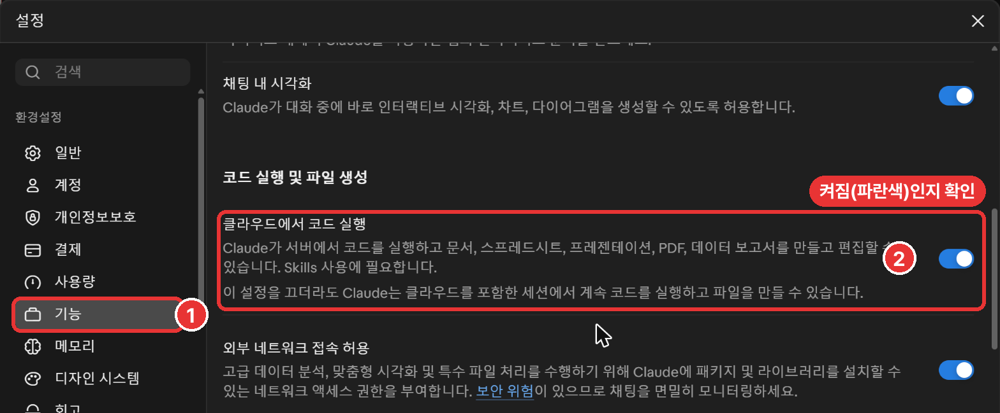
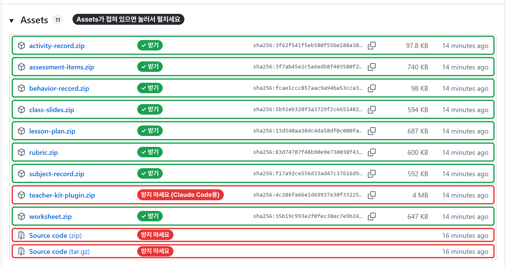
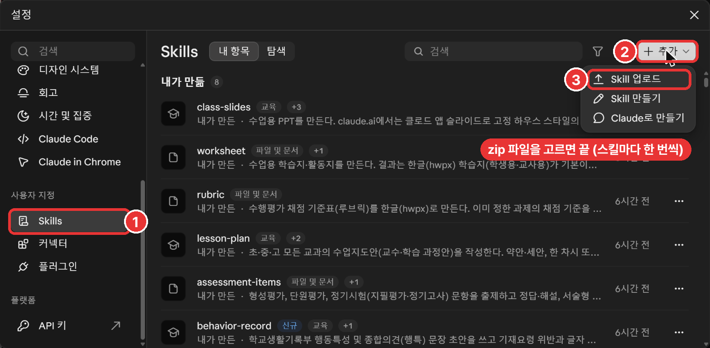
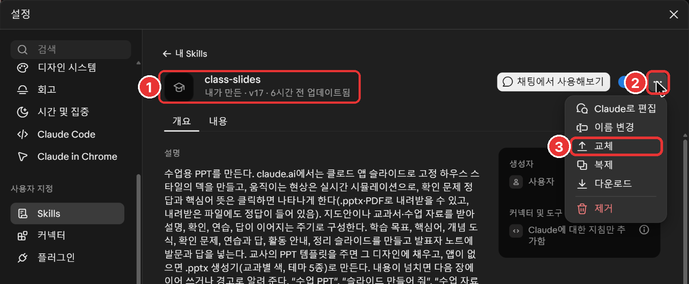

# 설치와 업데이트

teacher-kit을 쓰는 길은 두 가지입니다. 대부분의 선생님은 첫째(claude.ai)면 충분합니다.

- **claude.ai (웹, 데스크톱 앱)**: 스킬 파일(zip)을 내려받아 설정에서 올립니다.
- **Claude Code (플러그인)**: 명령 두 줄로 한 번에 설치합니다. 터미널을 쓰는 분께 맞습니다.

설치가 끝나면 [사용법](usage.md)으로 가세요. 막히면 [자주 묻는 질문](faq.md)을 보세요.

## 1. claude.ai (웹, 데스크톱 앱)

순서는 네 단계입니다. 처음 한 번만 하면 됩니다.

1. 설정에서 **클라우드에서 코드 실행**을 켭니다.
2. 릴리스 페이지에서 **스킬 zip 파일**을 내려받습니다.
3. 설정의 **Skills** 메뉴에서 zip 파일을 하나씩 올립니다.
4. 대화창에서 한 줄 써 보며 확인합니다.

### 1-1. '클라우드에서 코드 실행' 켜기

이 기능이 꺼져 있으면 한글, 엑셀, 파워포인트 파일을 만들 수 없습니다.

1. claude.ai(또는 데스크톱 앱) 왼쪽 아래의 **내 이름**을 누르고 **설정**을 엽니다.
2. 설정 창 왼쪽에서 **① 기능**을 누릅니다.
3. '코드 실행 및 파일 생성' 아래 **② 클라우드에서 코드 실행** 스위치가 파란색(켜짐)인지 확인합니다. 회색이면 눌러서 켭니다.



### 1-2. 릴리스 페이지에서 스킬 zip 내려받기

1. 아래 주소를 엽니다.
   **https://github.com/akaz01/claude-teacher/releases/latest**
   GitHub 가입이나 로그인은 필요 없습니다.
2. 화면을 조금 내리면 **Assets**라는 목록이 있습니다. 접혀 있으면 'Assets'를 눌러 펼칩니다.
3. 목록에서 **초록색으로 표시한 8개** 가운데 필요한 것을 눌러 내려받습니다. 무엇을 고를지 모르겠으면 8개를 모두 받으세요.



| 받을 파일 (초록) | 이런 일을 할 때 |
|---|---|
| `lesson-plan.zip` | 수업지도안. **처음 쓰는 분은 꼭 받으세요** (교사 프로필 만들기도 이 스킬이 맡습니다) |
| `worksheet.zip` | 학습지·활동지 |
| `class-slides.zip` | 수업 PPT |
| `assessment-items.zip` | 시험·평가 문항 |
| `rubric.zip` | 수행평가 채점기준표 |
| `subject-record.zip` | 교과세특 |
| `activity-record.zip` | 창체(자율·자치·동아리·진로) 특기사항 |
| `behavior-record.zip` | 행동특성 및 종합의견 |

**받지 않을 파일 (빨강)**

- `teacher-kit-plugin.zip`: Claude Code(개발자용 프로그램)에서 쓰는 묶음입니다. claude.ai에 올리면 오류가 납니다.
- `Source code (zip)`, `Source code (tar.gz)`: GitHub가 자동으로 붙이는 개발용 원본입니다. 스킬로 올릴 수 없습니다.

**내려받은 뒤 확인할 것**

- 파일은 보통 컴퓨터의 **다운로드** 폴더에 `lesson-plan.zip`처럼 저장됩니다.
- **압축을 풀지 마세요.** zip 파일 그대로 올립니다. 반디집·알집 등으로 '압축 풀기'를 하지 않습니다.
- **Mac의 Safari**는 내려받은 zip을 저절로 풀어 폴더로 만들 수 있습니다. 다운로드 폴더에 zip 대신 폴더가 보이면, Safari 설정의 '일반'에서 **'다운로드 후 안전한 파일 열기'** 체크를 끄고 다시 내려받으세요. Chrome이나 Edge는 풀지 않습니다.

### 1-3. Skills 메뉴에서 올리기

1. 1-1처럼 **설정**을 엽니다.
2. 설정 창 왼쪽 목록을 아래로 내려 '사용자 지정' 아래의 **① Skills**를 누릅니다.
3. 오른쪽 위 **② + 추가**를 누르고 **③ Skill 업로드**를 고릅니다.
4. 파일 고르는 창이 뜨면 다운로드 폴더에서 zip 파일 **하나**를 골라 엽니다.
5. 받은 zip마다 3~4를 되풀이합니다. 8개를 받았으면 8번 올립니다.



다 올리면 Skills 목록에 `lesson-plan`, `worksheet`처럼 올린 스킬 이름이 보입니다. 이름 오른쪽 스위치가 켜져 있어야 스킬이 일합니다.

> 메뉴 이름과 위치는 claude.ai 화면이 바뀌면 달라질 수 있습니다. 위 그림은 2026년 11월 화면입니다. 메뉴가 안 보이면 설정 창 위쪽 검색칸에 "Skills"를 입력해 보세요.

### 1-4. 잘 설치됐는지 확인

새 대화를 열고 아래처럼 써 보세요. 스킬이 학교급이나 차시를 묻거나 바로 지도안을 만들기 시작하면 설치된 것입니다.

```
지도안: 초5 사회 국토의 위치 1차시
```

- 올릴 때 오류가 나면 [자주 묻는 질문](faq.md)의 "업로드가 안 돼요"를 보세요.
- 학생부 세 스킬(`subject-record`, `activity-record`, `behavior-record`)은 서로 항목을 넘겨받는 일이 있어, 학생부를 쓰신다면 셋을 함께 올려 두면 편합니다.

### 1-5. 새 판이 나왔을 때 (업데이트)

1. 1-2처럼 릴리스 페이지에서 새 zip을 내려받습니다.
2. 설정 → **Skills**에서 바꿀 스킬의 **① 이름**을 눌러 상세 화면을 엽니다.
3. 오른쪽 위 **② ⋯** 단추를 누르고 **③ 교체**를 고른 뒤, **같은 이름**의 새 zip을 고릅니다. (예: `class-slides` 스킬에는 `class-slides.zip`)
4. 바꾼 뒤에는 새 대화를 열어 확인해 보세요.



## 2. Claude Code (플러그인)

Claude Code 안에서 아래 두 줄을 차례로 입력합니다.

```
/plugin marketplace add akaz01/claude-teacher
/plugin install teacher-kit@claude-teacher
```

터미널(셸)에서 바로 하려면 이렇게 입력합니다.

```
claude plugin marketplace add akaz01/claude-teacher
claude plugin install teacher-kit@claude-teacher
```

- **업데이트**: Claude Code 안에서 `/plugin marketplace update claude-teacher`를 입력합니다.
- **지우기**: Claude Code 안에서 `/plugin uninstall teacher-kit@claude-teacher`를 입력합니다.
- 플러그인에는 스킬 8개가 모두 들어 있습니다. 골라 설치하는 방식이 아닙니다.
- Claude Code에서는 클로드 앱의 슬라이드와 디자인 기능이 없어 수업 PPT를 파이썬 생성기로 만듭니다. 이 생성기를 쓰려면 파이썬과 `python-pptx`가 필요합니다.

## 3. 처음 설정: 교사 프로필 만들기

학교급, 담당 학년, 담당 교과를 한 번 알려 두면 스킬마다 같은 질문을 되풀이하지 않습니다. 대화창에 이렇게 말하세요.

```
프로필 설정해 줘
```

이 일은 **수업지도안(`lesson-plan`) 스킬**이 맡습니다. 새 학년도(3월)가 되면 "프로필 다시 설정해 줘"라고 말씀하세요.

### 무엇을 묻나요

한 번에 모아서 묻습니다. 이미 말씀하신 내용은 다시 묻지 않습니다.

1. 학교급: 초등, 중학교, 고등학교
2. 담당 학년 (여러 개 가능)
3. 담당 교과(과목). 초등 담임이면 "전 교과"라고 쓰셔도 됩니다
4. 담임 여부
5. 학교 사정 (선택): 블록 수업, 차시 시간 변경, 특수학급, 혁신학교 등
6. 소속 교육청 (선택)

교사 이름, 학교 이름, 연락처는 묻지 않습니다. 필요 없는 정보이기 때문입니다.

### 어떤 결과가 나오나요

아래처럼 생긴 **프로필 블록**을 만들어 줍니다. 값은 예시입니다.

```
[교사 프로필]
- 기준 학년도: 2026학년도
- 학교급: 중학교
- 담당 학년: 2학년, 3학년
- 담당 교과: 과학
- 담임: 2학년 담임
- 적용 교육과정: 2학년 2022 개정 / 3학년 2015 개정
- 성적 체계: 성취평가 A~E (체육·예술 A~C)
- 1차시: 45분
- 학교 사정: 없음
- 소속 교육청: (미입력)
- 학생 정보 원칙: 학생은 가명(학생A 등)으로만 입력
```

말씀하시지 않은 값은 지어내지 않고 `(미입력)`으로 둡니다.

### 저장해 두기

> **저장 방법 (둘 중 하나)**
> 1. **프로젝트 사용 (추천)**: claude.ai에서 "프로젝트"를 하나 만들고(예: "2026 수업"), 프로젝트 지침(instructions)에 위 블록을 붙여 넣으세요. 그 프로젝트 안의 모든 대화에 자동으로 적용됩니다.
> 2. **개인 설정**: 설정의 프로필 메뉴에 있는 개인 선호 사항 칸에 붙여 넣으세요. 모든 대화에 적용됩니다.
>
> 새 학년도(3월)가 되면 "프로필 다시 설정해 줘"라고 말씀해 주세요.

## 4. 설치 확인하기

대화창에 아래처럼 말해 보세요. 스킬이 첫 질문을 하면 잘 설치된 것입니다.

```
지도안: 중2 과학 물질의 구성 1차시
```

- 질문이 오지 않고 일반 답만 오면 [자주 묻는 질문](faq.md)의 "스킬이 불리지 않아요"를 보세요.
- 파일이 만들어지지 않으면 1-1의 기능이 켜져 있는지 확인하세요.
